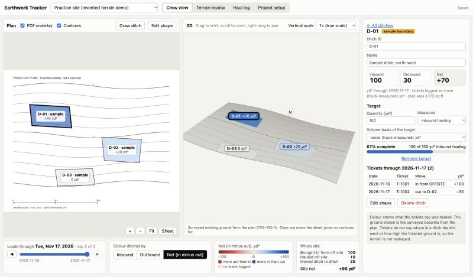
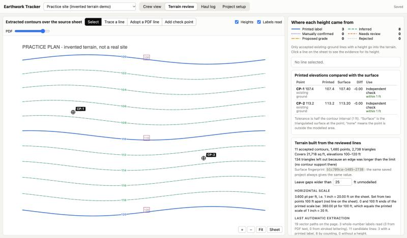

# Earthwork Tracker

A local web app that turns a civil grading-plan PDF into a reviewed 3D terrain,
lets a crew draw work regions ("ditches") on it, and colours those regions by
the dirt hauled in and out according to a ticket spreadsheet.

Everything runs on your own computer. There are no accounts, no paid services,
and no outside elevation data: the terrain comes only from the contours on your
sheet.



## Contents

- [Quick start](#quick-start)
- [The two demos](#the-two-demos)
- [The four tabs](#the-four-tabs)
- [Using your own plan and haul log](#using-your-own-plan-and-haul-log)
- [The haul-log CSV](#the-haul-log-csv)
- [How the terrain is built](#how-the-terrain-is-built)
- [Troubleshooting](#troubleshooting)
- [Commands](#commands)
- [Where things live](#where-things-live)
- [Known limits](#known-limits)

## Quick start

You need **Python 3.9 or newer** and **Node.js 18 or newer**, on macOS or Linux.
(On Windows, run it inside WSL: the scripts use Unix paths.)

```bash
git clone https://github.com/spanglr/earthwork-tracker.git
```

```bash
cd earthwork-tracker
```

```bash
npm run setup
```

```bash
npm start
```

Then open <http://localhost:5173>.

- `npm run setup` is needed once. It creates a Python environment in `.venv`,
  installs the Python packages, and installs the Node packages.
- `npm start` runs two things together: the local API on port 8787 and the web
  app on port 5173. Stop both with Ctrl+C.
- The first start takes a few seconds longer because the demo terrain is
  extracted from its PDF. The page waits and loads by itself.

## The two demos

**Practice site** ships with the code and opens on a fresh clone. It is an
invented sheet (`samples/practice-plan.pdf`, 1 inch = 20 ft, 2 ft contours)
with three sample ditches and three sample tickets. Use it to learn the app.

**Rhythm Square, Pittsburgh** is a real grading plan: sheet C-2.1 of a public
City of Pittsburgh zoning submission for 2239 Centre Avenue. The drawing
belongs to its authors, so the PDF is not in this repository. To install it:

1. Open
   [the PDF on the city's site](https://www.pittsburghpa.gov/files/assets/city/v/1/dcp/documents/zoning-board-of-adjustment/24278_zba_040_of_2024_dcp-zdr-2023-08746_2239_centre_ave.pdf)
   in a web browser and save it. The city's server refuses command-line
   downloads such as `curl`.
2. Put it at `source-pdf/rhythm-square-zba.pdf`.
3. Restart the app, or open **Project setup** and press **Build this demo**.

Once installed it becomes the project the app opens into. It shows the harder
case: contours plotted as dashed line work, elevation labels drawn as strokes
rather than text, building lines in the same style as contours, and a review
record with printed-label, counted and hand-confirmed heights.

In both demos the ditch boundaries and haul tickets are made-up samples.

## The four tabs

| Tab | What it is for |
| --- | --- |
| **Crew view** | Plan and orbitable 3D of the same area, side by side. Click a ditch in either one and both highlight it. Date slider, colour by inbound / outbound / net, legend, per-ditch tickets and targets. Draw and edit ditches here. |
| **Terrain review** | The extracted contours drawn over the source sheet, coloured by where each height came from. Click a line to see the evidence. Confirm a height, reject a line, trace a missing one, adopt a line from the PDF, and compare printed spot elevations with the surface. |
| **Haul log** | Import the ticket CSV with a preview first. Totals per ditch and for the whole site, and the full log. |
| **Project setup** | Projects, new project, page, horizontal scale, contour interval, which line styles are contours, run extraction. |



### Crew view in a minute

- **Select**: click a ditch on the plan, in 3D, or in the table. The side panel
  shows its inbound, outbound and net cubic yards and the tickets behind them.
- **Date**: drag the slider. Totals are *through* the selected day.
- **Colour**: choose inbound, outbound or net. The legend shows the scale. Net
  uses blue for more in than out and red for more out than in.
- **PDF underlay**: tick or untick it above the plan.
- **Vertical scale**: 3D is true scale by default. If you choose 2× or more, a
  flag on the view says the slopes are exaggerated.
- **Draw ditch**: press the button, click each corner, double-click (or press
  Enter) to finish. Then set its ID in the side panel.
- **Edit shape**: drag a corner, click a small grey point to add a corner,
  double-click a corner to remove it.
- **Target**: add one per ditch and say what it measures (inbound hauling,
  outbound hauling, net fill, net cut) and on what volume basis. A percentage
  is shown only when the target's basis matches the tickets' basis, because a
  cubic yard in a truck is not a cubic yard in the ground.

The ground in 3D is the surveyed baseline from the plan. Colour shows hauling
progress. Tickets do not say where in a ditch the dirt went or how high the
finished ground is, so the terrain is never reshaped by them.

## Using your own plan and haul log

1. **Project setup → New project.** Give it a name, choose the plan PDF (or a
   scan as PNG, JPG or TIFF), and press **Create project**. The file is copied
   into `projects/` on this computer and goes nowhere else.

2. **Pick the sheet.** The table lists every page with what is on it: vector
   paths, text, images. Press **Use this page** on the grading plan.
   - *Vector drawing* means lines can be extracted automatically.
   - *Scanned image* means you will trace the contours by hand.

3. **Set the horizontal scale.** Press **Pick two points**, click the two ends
   of the printed scale bar (or of any printed dimension), and type the
   distance in feet. On a vector PDF the click snaps to the nearest line end.
   If the sheet prints a scale such as "1 inch = 20 ft", type that too: the app
   tells you whether the two agree. Press **Use the two points**. On a scan or
   a reduced print, trust the measured points, not the printed scale.

4. **Tell it which lines are contours.** Enter the contour interval and the
   index-contour interval. Tick **show** beside a line style to see it
   highlighted on the sheet. Set the contour styles to *Existing: index
   contours*, *Existing: intermediate contours* or *Proposed contours*, and
   leave everything else as *not a contour*. If the sheet has a legend, use it.
   Press **Extract contours**.

5. **Review the result in Terrain review.** Nothing is part of the terrain
   until it is accepted.
   - Press **Accept N automatic heights with no warnings** to take the lines
     whose height came from a printed label or an exact count.
   - Press **Next line needing review** and deal with each remaining line:
     read the height from the sheet, type it and press **Confirm height**, or
     press **Reject: not a contour**.
   - Use **Trace a line** to draw a contour the extraction missed, and **Adopt
     a PDF line** to take a line's exact geometry from a vector PDF.
   - Look over the accepted lines as well. Automatic heights can be wrong, and
     line work that is not a contour can slip in when it is drawn in the same
     style.

6. **Add check points.** Press **Add check point**, click the tick mark of a
   printed spot elevation, and type its value. Say what it refers to: ground,
   or a curb, wall or floor that should not be compared with ground. Keep a few
   that you did not use to decide any height. The table shows the printed
   value, the surface value and the difference.

7. **Draw the ditches** in Crew view and set each ID to match the spreadsheet.

8. **Import the haul log** in the Haul log tab. Choose the CSV, read the
   preview, then press **Add N new tickets**.

For a **scan**, step 4 extracts nothing. Calibrate it, then in Terrain review
trace each contour over the image and type its height. If traced contours are
far apart, raise *Leave gaps wider than … unmodelled* so the ground between
them is filled in.

`samples/practice-plan.pdf` and `samples/practice-scan.png` are there for a dry
run of both paths.

## The haul-log CSV

```
ticket_id,date,from_id,to_id,volume_yd3
T-1001,2026-11-16,OFFSITE,D-01,100
T-1002,2026-11-17,D-01,D-02,30
T-1003,2026-11-17,D-02,OFFSITE,10
```

That file is `samples/haul-tickets-example.csv`, and the Haul log tab has a
download link for it.

| Column | Meaning |
| --- | --- |
| `ticket_id` | Unique ID of the load. This is how a repeated import is recognised. |
| `date` | `YYYY-MM-DD`. `M/D/YYYY` is also read. |
| `from_id` | Ditch ID the dirt left, or `OFFSITE` if it came from off site. |
| `to_id` | Ditch ID the dirt reached, or `OFFSITE` if it left the site. |
| `volume_yd3` | Cubic yards, greater than zero. |

Extra columns are ignored. `OFFSITE` is reserved and cannot be used as a ditch
ID.

**How totals are calculated**, through the selected date:

- A ticket adds its volume to *outbound* for `from_id` and to *inbound* for
  `to_id`. Net is inbound minus outbound.
- A ditch-to-ditch ticket is therefore one outbound entry and one inbound
  entry, and adds nothing to the site-wide net.
- Site net is what came in from `OFFSITE` minus what went out to `OFFSITE`.

With the example file: on day 1, D-01 is +100 and D-02 is 0. At the end of
day 2, D-01 is 100 in, 30 out, net +70; D-02 is 30 in, 10 out, net +20; and
the site net is +90.

**What the preview flags.** Each line is marked before anything is saved:

| Result | Meaning | What happens |
| --- | --- | --- |
| New | Valid and not in the log | Added when you press the button |
| Already counted | Identical to a ticket in the log, or to an earlier line | Skipped, so importing the same file twice never double-counts |
| Conflict | Same `ticket_id` as another ticket but different values | Skipped. If it conflicts with a logged ticket you can tick a box to replace that ticket |
| Problem | Unknown ditch ID, invalid date, quantity not greater than zero, missing value, same place on both ends | Skipped. Fix the spreadsheet and import again |

## How the terrain is built

1. **Read the page.** Every stroked path is taken from the PDF in sheet
   coordinates (PDF points on the displayed page). Contours, mesh, ditches and
   check points all use these same coordinates, so nothing is ever
   re-registered against the underlay.
2. **Join the dashes.** Plotted linetypes arrive as separate dashes. Dashes
   that continue each other across one dash gap are joined into candidate
   contours. Pieces that meet at a junction or a sharp corner are kept apart.
3. **Read the labels.** Real PDF text is used when present. Many CAD sheets
   draw lettering as strokes instead, so stick-font digits are recognised by
   shape. Anything that does not match a digit closely is ignored, not guessed.
4. **Tie labels to lines.** A label normally sits in a break in its contour.
   The two line ends pointing at it are bridged and the line takes that height.
5. **Count the rest.** For an unlabeled line, short cross-lines are drawn
   square across it. If a known contour lies on each side and the number of
   lines in between is exactly the height difference divided by the interval,
   every line in between has a definite height. Each cross-line is a vote, and
   a height is assigned only when the votes agree. A line that cannot be
   settled this way stays without a height.
6. **Review.** You accept, correct, reject or add lines. Every decision is
   saved with the project.
7. **Triangulate.** Accepted existing-ground contours are triangulated.
   Triangles with an edge longer than the gap limit are dropped, so building
   footprints and areas the sheet gives no contours for stay empty rather than
   being bridged with invented ground.

Each line in Terrain review is one of:

| Colour | Meaning |
| --- | --- |
| Blue, solid | **Printed label**: height read from a label on that line |
| Green, dashed | **Inferred**: counted between labeled lines |
| Violet, dotted | **Manually confirmed**: typed or confirmed by the reviewer |
| Orange, dash-dot | **Needs review**: not in the terrain yet |
| Amber, long dash | **Proposed grade**: kept separate, never in the terrain |
| Grey, sparse dots | **Rejected**: not a contour |

What the terrain is not:

- It is existing ground only. Proposed contours are shown as lines.
- Above the highest contour and below the lowest one it is flat. A
  contour-only surface cannot know the height of a summit, so expect a printed
  spot elevation on a hilltop to sit above it.
- It is a planning aid built from a drawing, not a survey.

A project is one folder under `projects/` holding the source file, the page
image and `project.json`: calibration, extracted geometry, every review
decision, traced lines, check points, ditches and tickets. Reopening a project
rebuilds the surface from that file. Terrain review shows a fingerprint of the
surface so you can see it is the same. To back up or move a project, copy its
folder.

## Troubleshooting

| What you see | What to do |
| --- | --- |
| "Cannot reach the local API on port 8787" | `npm start` is not running, or the API failed to start. Look at the terminal for the lines marked `[api]`. |
| `Port 5173 is already in use` | Another copy is running. Stop it, or stop whatever else uses that port. |
| `npm run setup` fails at `python3 -m venv` | Install Python 3.9 or newer and make sure `python3` is on your path. |
| Only the practice demo appears | The Pittsburgh PDF is not installed. See [The two demos](#the-two-demos). |
| "No vector line there" when adopting a line | Zoom in and click directly on the line, or trace it instead. Scans have no vector lines. |
| Extraction finds lines that are not contours | Some other line work shares the contour style. Reject those lines in Terrain review. |
| Lines have no height after extraction | The labels were not readable or the count was not consistent. Click the line, read the height on the sheet, and confirm it. |
| The 3D view has large holes | Neighbouring contours are further apart than the gap limit. Raise *Leave gaps wider than* in Terrain review, if those lines really are neighbours. |
| Measured scale and printed scale disagree | Normal for a scan or a reduced print. Use the two measured points. |

## Commands

| Command | What it does |
| --- | --- |
| `npm run setup` | One-time install of Python and Node packages |
| `npm start` | Run the API and the web app |
| `npm test` | Ticket math, CSV checks and terrain checks |
| `npm run test:python` | PDF pipeline checks (takes about a minute) |
| `npm run demo:rebuild` | Rebuild the demo projects from their sheets |
| `npm run overlay` | Write `docs/overlay-review.png`: the Pittsburgh demo's contours drawn over its sheet |
| `npm run build` | Type-check and build the web app into `dist/` |

The terrain tests read the demo projects, so start the app once (or run
`npm run demo:rebuild`) before `npm test` on a fresh clone. Tests for a demo
that is not installed are skipped.

## Where things live

```
backend/             Python: PDF reading, contour extraction, local API
  pdfgeom.py           vector paths, text, page image, tick marks
  contours.py          dash joining, label attachment, height counting
  strokefont.py        reads stick-font digits plotted as line work
  extract.py           the extraction pipeline
  projects.py          project files on disk
  demo.py              builds the demo projects from demo/<name>/config.json
  server.py            local API on 127.0.0.1:8787
  tests/               pipeline tests
  tools/               practice-sheet generator, overlay renderer, digit templates
demo/                everything specific to each demo sheet
samples/             practice sheet, practice scan, example CSV
source-pdf/          where the Pittsburgh PDF goes (not in the repository)
src/                 React + TypeScript + React Three Fiber app
  lib/terrain.ts       triangulation and surface sampling
  lib/haul.ts          CSV checks, totals, targets
  components/          the four tabs, plan canvas, 3D view
projects/            your projects, created on first run (not in the repository)
```

## Known limits

- Automatic extraction needs a vector PDF. Contours are found by line style, so
  a sheet that draws contours in the same style as other line work will
  produce false candidates to reject.
- Stroked labels are read only when they are stick-font digits (AutoCAD
  Simplex/RomanS style). The digit shapes were taken from one sheet. Other
  lettering is not read: confirm those heights by hand.
- Calibration sets scale only. A scan that is skewed or stretched unevenly will
  not measure correctly.
- The triangulation does not force triangle edges to follow contours, and it
  can form flat triangles along a single contour.
- Developed and tested in a Chromium browser on macOS.
